# QuickEmbed

Quick, local embedding inference for [google/embeddinggemma-2](https://huggingface.co/google/embeddinggemma-2)
(740M, multimodal, Apache 2.0), with an optional cloud/GPU fallback and a
terminal dashboard for watching queries and live compute usage on one
screen. See [PROPOSAL.md](PROPOSAL.md) for the full architecture, system
constraints, and phased deployment plan (mobile/browser/desktop/cloud), or
[docs/GETTING_STARTED.md](docs/GETTING_STARTED.md) for an expanded,
step-by-step first-time setup walkthrough.

## Demo



## Requirements

- Python 3.10+ (developed/tested on 3.12.13)
- ~2GB free disk (1.5GB model weights + ~500MB of CPU torch/transformers wheels)
- ~2GB free RAM for CPU inference (observed RSS: ~1GB with the full multimodal checkpoint loaded)
- No GPU required for local/on-device use. GPU + Docker only needed for the
  optional cloud tier — see [`deploy/cloud/`](deploy/cloud/).
- Internet access on first run only, to pull the model from Hugging Face
  (public repo, no auth token needed).

## Run it locally

```bash
python3 -m venv .venv && source .venv/bin/activate   # optional but recommended
pip install -r requirements.txt

python3 -c "from huggingface_hub import snapshot_download; \
  snapshot_download('google/embeddinggemma-2', local_dir='models/embeddinggemma-2')"

PYTHONPATH=src pytest tests/test_smoke_text.py -v      # sanity check
PYTHONPATH=src python3 -m embedding_service.dashboard   # the live dashboard
```

Type a query and press Enter; press `q` (with empty input) or Ctrl-C to quit.

Documents it searches against come from [`docs/corpus.txt`](docs/corpus.txt)
(one per line) — edit that file to search your own text, or point at a
different file with `EMBEDDING_DOCS_FILE=/path/to/corpus.txt`. A line can
also be a path (relative to the corpus file) to an image or video instead
of literal text: images are embedded with the vision encoder, and video is
embedded by sampling a few evenly-spaced frames through the same encoder
and averaging them (this model has no dedicated video encoder — see
`src/embedding_service/config.py` for the text/vision/audio modalities it
actually ships).

### MCP server

The same retrieval logic is also exposed as MCP tools (`search_corpus`,
`embed_text`, `corpus_info`, `reload_corpus`) in
[`mcp_server.py`](src/embedding_service/mcp_server.py), so an MCP client
(Claude Code, Claude Desktop, etc.) can call into it directly instead of
only a human at the dashboard's terminal:

```bash
PYTHONPATH=src python3 -m embedding_service.mcp_server
```

Register it in an MCP client's config (e.g. a project's `.mcp.json`):

```json
{
  "mcpServers": {
    "quickembed": {
      "command": "python3",
      "args": ["-m", "embedding_service.mcp_server"],
      "env": { "PYTHONPATH": "src" }
    }
  }
}
```

The model is loaded once at server startup (not per call) — the first tool
call after launch will be slow (model load), subsequent calls reuse it.
`EMBEDDING_DOCS_FILE`/`EMBEDDING_CLOUD_URL` env vars work the same as for
the dashboard; use the `reload_corpus` tool to pick up corpus edits without
restarting the server.

### Optional: cloud backend

Point at a running vLLM server (see [`deploy/cloud/docker-compose.vllm.yml`](deploy/cloud/docker-compose.vllm.yml))
instead of/alongside on-device inference:

```bash
EMBEDDING_CLOUD_URL=http://<host>:8000 PYTHONPATH=src python3 -m embedding_service.dashboard
```

## Troubleshooting

- `ModuleNotFoundError: torchvision` — needed by the vision image processor
  import even for text-only use. Fix: `pip install torchvision` (CPU wheel
  is fine).
- `ModuleNotFoundError: requests` — needed by `backends/cloud.py` even when
  the cloud backend isn't used, since the module is imported at class-
  definition time. Fix: `pip install requests` (already in `requirements.txt`).

## Other deployment targets

Mobile (LiteRT), browser (ONNX/WebGPU), and desktop/edge (Ollama/llama.cpp)
instructions live under [`deploy/ondevice/`](deploy/ondevice/) — documented
but not exercised in this dev container (no phone/browser/GPU available
here). See [PROPOSAL.md](PROPOSAL.md) for what's been verified vs. what's
documented-only.
